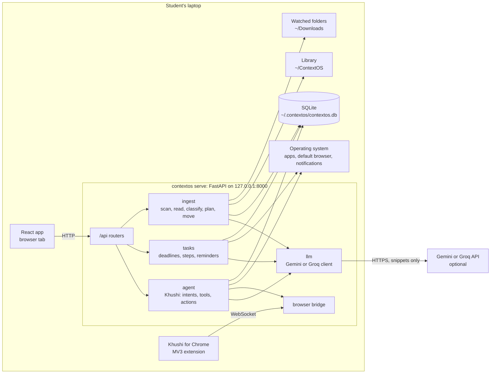
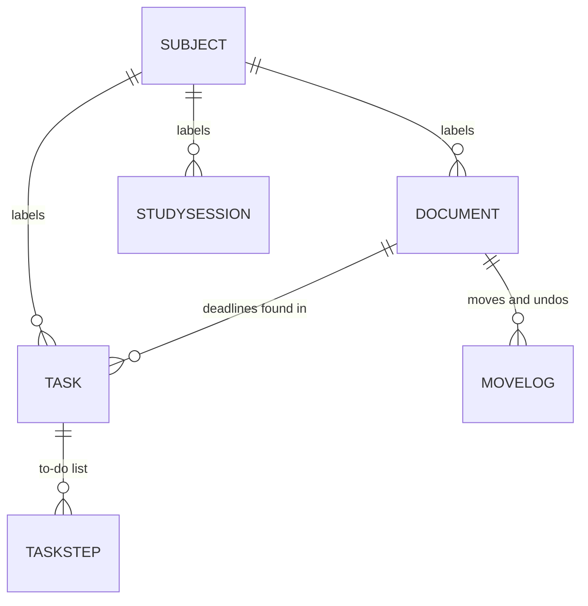
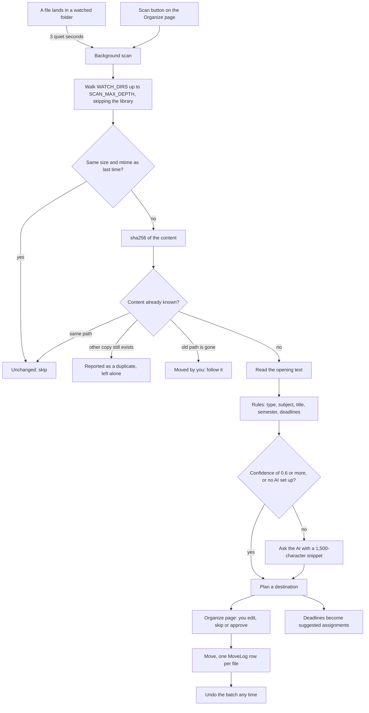
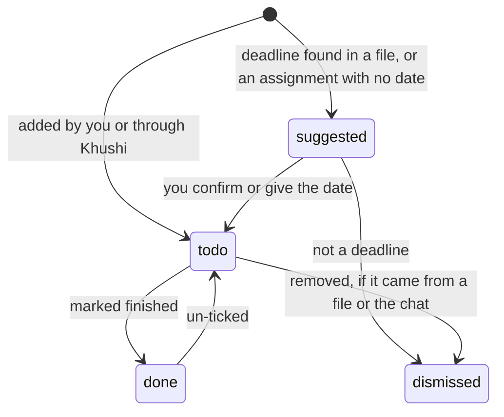
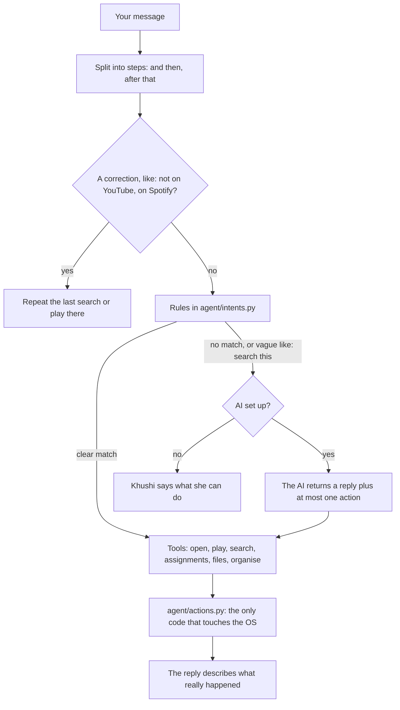
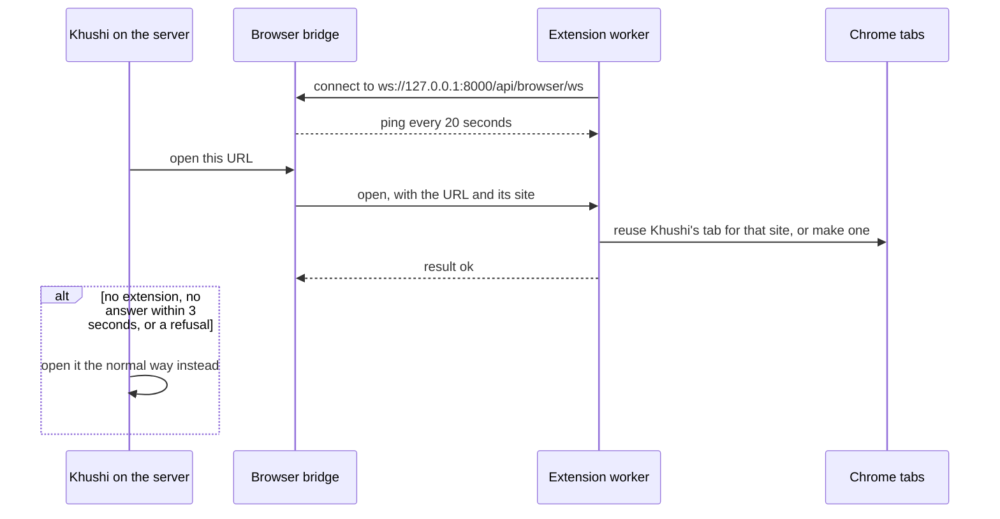

# ContextOS architecture

How ContextOS is built today: the parts, how data moves between them, and the
rules every part follows. It describes the code at commit `bcb3706`
(30 October 2026). What comes next is in [PLAN.md](PLAN.md).

## 1. In one paragraph

ContextOS is a local desktop agent for university students. A FastAPI server
runs on the student's own laptop (`127.0.0.1:8000`) next to one SQLite file.
It watches the Downloads folder, reads each new PDF, Word, PowerPoint or image
file, works out its subject and type, and proposes a tidy library
(`Semester / Subject / Type /`). Nothing moves until the student approves, and
every move can be undone. Deadlines found inside files become suggested
assignments with to-do lists and desktop reminders. Khushi, the assistant,
talks through a chat panel on every page: everyday commands ("open Spotify",
"what's due this week?") are handled by rules on the laptop, and only
open-ended questions go to a free-tier AI model (Gemini or Groq), which is
optional.

## 2. The rules every part follows

| Rule | Where it is enforced |
|---|---|
| Never delete a user's file: only move, never overwrite | `ingest/mover.py` - `_move` refuses an existing target |
| Nothing moves without approval | a scan only writes a plan (`DocStatus.planned`); files move on `POST /api/organize/apply` |
| Every move can be undone | one `MoveLog` row per file, committed file by file; `mover.undo_batch` |
| Deadlines found in files are suggestions | `TaskStatus.suggested` until the student answers |
| Rules first, AI second | `classify.LLM_THRESHOLD` (0.6); `agent/intents.py` runs before `agent/chat._ask_llm` |
| Everything works with no AI | `LLM_PROVIDER=none`; any AI exception falls back to rules; tests run in this mode |
| Only a snippet of a document leaves the laptop | `LLM_SNIPPET_CHARS` (default 1,500 characters) |
| Local actions are allowlisted | `agent/actions.py`: apps from `agent/apps.py`, `http`/`https`/`spotify` links, files inside the library or watched folders |
| Khushi never claims what did not happen | replies are written from tool results; `chat._CLAIMS_ACTION` |
| Only this laptop may call the API | Host and Origin checks in `main.create_app`; WebSocket checks in `api/browser.py` |
| CPU only | no GPU dependencies anywhere |

## 3. System at a glance



## 4. Tech stack

| Layer | Tools | Why |
|---|---|---|
| Server | Python 3.11+, FastAPI, Uvicorn | one local process serves the API and the built UI |
| Storage | SQLite through SQLModel / SQLAlchemy, WAL mode, foreign keys on | a single file, nothing to install |
| Settings | pydantic-settings | environment variables and a `.env` file, typed |
| AI | Gemini REST API or Groq's OpenAI-compatible API, called with httpx | free tiers, no vendor SDKs |
| Reading files | PyMuPDF, Tesseract through pytesseract, python-docx, python-pptx | PDF text and page images, OCR for scans and photos, Office files |
| Background work | watchdog, Python threads | folder watching, scans, reminder checks |
| Notifications | `notify-send` (Linux), `osascript` (macOS), plyer (Windows) | Khushi's reminders |
| UI | React 19, React Router 7, Vite 8, TypeScript 6, Tailwind CSS 4; Gabarito and Figtree fonts bundled through fontsource | single-page app styled by the design system in [DESIGN.md](DESIGN.md); Recharts 3 is installed for the Phase 04 charts |
| Voice | the browser's `speechSynthesis` and `webkitSpeechRecognition` | no downloads, no server work |
| Chrome extension | Manifest V3 service worker (Chrome 116+) | reuses one tab per site, opens the first result |
| Quality | pytest, ruff, vitest, oxlint, tsc, `node --test` | one command per part, all must pass |

Versions installed and tested on 30 October 2026: Python 3.13.5, FastAPI 0.162.0,
Uvicorn 0.54.0, SQLModel 0.0.48, SQLAlchemy 2.1.6, Pydantic 2.14.2, httpx 0.28.1,
PyMuPDF 2.0, watchdog 6.0.0, plyer 2.1.0, React 19.3.0, Vite 8.3.1,
TypeScript 6.0.3, Tailwind CSS 4.3.3, Recharts 3.10.1, Node 22.17.0.

The backend's heavier dependencies are opt-in extras in `backend/pyproject.toml`:

| Extra | Brings | Needed for |
|---|---|---|
| `llm` | httpx | Gemini or Groq |
| `ingest` | pymupdf, pytesseract, python-docx, python-pptx, watchdog | reading files, OCR, folder watching |
| `reminders` | plyer (and APScheduler, which nothing imports) | desktop notifications on Windows |
| `dev` | pytest, ruff, httpx | tests and lint |

## 5. Repository map

```text
context.os/
├── backend/
│   ├── pyproject.toml           package, extras, ruff and pytest settings
│   ├── scripts/make_demo_files.py   a folder of messy demo files to try it safely
│   ├── src/contextos/
│   │   ├── main.py              app factory, startup, localhost guard, serves frontend/dist
│   │   ├── cli.py               `contextos serve`, `contextos init-db`
│   │   ├── config.py            every setting, with defaults
│   │   ├── db.py                SQLite engine, additive migrations
│   │   ├── models.py            tables and enums
│   │   ├── security.py          which hosts count as this laptop
│   │   ├── frontend.py          where the built UI is, and its build id
│   │   ├── browser.py           the bridge to the Chrome extension
│   │   ├── api/                 routers: health, organize, subjects, files, tasks, chat, browser
│   │   ├── ingest/              scanner, extract, ocr, classify, planner, pipeline, mover, jobs, watcher
│   │   ├── tasks/               deadlines, service, steps, reminders
│   │   ├── agent/               chat, intents, tools, actions, apps, music, khushi, notify
│   │   ├── llm/                 base (retries, fallback, JSON), gemini, groq, cache, ratelimit
│   │   └── progress/            empty: Phase 04 goes here
│   └── tests/                   pytest suites and fixtures
├── frontend/src/
│   ├── App.tsx                  routes
│   ├── pages/                   Dashboard, Organize, Files, Tasks, Chat, Settings
│   ├── components/              Layout, ChatPanel, Khushi, UpdateBanner, VoiceSettings, ExtensionSettings, ...
│   └── lib/                     api.ts (fetch wrapper and types), voice.ts, labels.ts
├── browser-extension/           Khushi for Chrome: manifest.json, background.js, khushi.js, tests
├── docs/                        ARCHITECTURE.md (this file), PLAN.md, DESIGN.md
├── CLAUDE.md                    working rules for contributors (AGENTS.md points to it)
└── .env.example                 the common settings, documented
```

## 6. What happens when you run `contextos serve`

1. `cli.py` reads the settings (`config.Settings`: environment variables,
   which take priority, and a `.env` file in the folder you start it from,
   which is why it is started from `backend/`) and runs Uvicorn on
   `HOST:PORT`, `127.0.0.1:8000` by default.
2. On startup, `main.lifespan`:
   1. creates missing tables and adds missing columns (`db.init_db`);
   2. gives every assignment already in the database its task
      (`tasks.service.ensure_assignment_tasks`);
   3. if `REMINDERS_ENABLED`, starts the reminder thread, which checks at once
      and then every `REMINDER_CHECK_MINUTES` (15);
   4. if `WATCH_ENABLED` and watchdog is installed, starts a folder watcher on
      each `WATCH_DIRS` folder.
3. `create_app` adds the localhost guard, mounts the API under `/api` and, when
   `frontend/dist` exists, serves the built UI: hashed files under `/assets`
   can be cached, and `index.html` is sent with `Cache-Control: no-cache`, so a
   rebuild is picked up.

| Thread | Started by | Job |
|---|---|---|
| Uvicorn event loop | `cli.py` | HTTP and the extension's WebSocket |
| FastAPI thread pool | every plain `def` route | the request handlers; this is why a chat request can wait for the extension's answer |
| `contextos-scan` | `ingest.jobs.ScanJob.request` | one scan at a time; a request during a scan queues one re-run |
| `khushi-reminders` | `tasks.reminders.ReminderLoop` | reminder checks |
| watchdog observer and timers | `ingest.watcher.FolderWatcher` | file events, then a scan after 3 quiet seconds |

## 7. Data model



`ActivityEvent`, `ChatMessage` and `Setting` stand alone.

| Table | Holds | Key fields |
|---|---|---|
| `Subject` | the student's courses | `name` (unique), `code`, `aliases` (JSON list, e.g. `["DBMS", "BCS403"]`), `semester`, `color` |
| `Document` | what ContextOS knows about each file | `sha256` (unique), `original_path`, `current_path`, `planned_path`, `doc_type`, `subject_id`, `title`, `semester`, `confidence`, `classified_by` (`rules` or the provider's name), `extraction` (`pdf`, `ocr`, `ocr_unavailable`, `docx`, `pptx`, `image`, `none`), `text_snippet` (first 500 characters), `status`, `error` |
| `MoveLog` | every move, for undo | `batch_id`, `document_id`, `from_path`, `to_path`, `moved_at`, `undone` |
| `Task` | assignments and reminders | `title`, `notes`, `subject_id`, `due_at`, `source` (`manual`, `chat`, `extracted`), `source_document_id`, `status`, `completed_at`, `reminded_days` |
| `TaskStep` | one line of a to-do list | `task_id`, `text`, `done`, `position`, `written_by` (`you`, `rules` or the provider's name) |
| `StudySession` | study time | `subject_id`, `started_at`, `ended_at`, `minutes`; defined, not used yet (Phase 04) |
| `ActivityEvent` | things worth counting in a week | `kind` (`task_done`, `files_organized`, `session`), `ref_id`, `count`, `at`; written when a task is finished (removed if it is un-ticked) and for each organised batch; `session` is not used yet |
| `ChatMessage` | the conversation with Khushi | `role` (`user` or `khushi`), `text`, `payload` (JSON: actions, task and file cards, suggestions, who answered, context) |
| `Setting` | key/value pairs | defined, not used yet |

Enums: `DocType` is `notes`, `slides`, `assignment`, `question_paper`, `lab`,
`syllabus`, `notice`, `other`. `DocStatus` is `new`, `planned`, `organized`,
`skipped`. `TaskStatus` is `suggested`, `todo`, `done`, `dismissed`.

Time rules:

- `Task.due_at` is local wall-clock time without a time zone: a deadline is
  "23:59 on the 12th" wherever the laptop is. Dates become 23:59 that day
  (`tasks.service.DUE_TIME`).
- Every other timestamp is a UTC instant. SQLite stores it as text without an
  offset (`2026-10-29 19:42:39.232380`), and it reads back as UTC.

Migrations are additive only: `db._add_missing_columns` adds a new column to an
existing table, so a new column must be nullable or have a default. Nothing
renames or drops columns.

## 8. The organiser



**Finding files** (`ingest/scanner.py`). Supported: `.pdf`, `.docx`, `.pptx`,
`.jpg`, `.jpeg`, `.png`. Skipped: hidden files, Office lock files (`~$...`),
unfinished downloads (their suffix is not supported), empty files, files over
200 MB, hidden folders and `node_modules`, `__pycache__`, `venv`, `.venv`,
`site-packages`. The library itself is never scanned, even when it sits inside
Downloads. Originals are processed before copies, so `notes.pdf` is kept and
`notes (1).pdf` is the duplicate.

**Reading** (`ingest/extract.py`, `ingest/ocr.py`). Only the opening of a file
is read: the first 3 PDF pages, Word paragraphs plus the first 3 tables, the
first 8 slides. A PDF with under 50 characters of text is treated as a scan and
its first 2 pages are OCR'd at 200 dpi, when Tesseract is installed. Photos are
OCR'd. Text is cleaned and cut to 6,000 characters. Password-protected and
corrupt files are recorded with an error instead of stopping the scan.

**Classifying** (`ingest/classify.py`), rules first:

- Type: keyword patterns for each type score 3 in the file name and 1 in the
  first 3,000 characters; a `.pptx` adds 4 to slides. Confidence is
  `min(1, top / 4)`, cut to 60% when the runner-up is within 2 points.
- Subject: a subject's name, code or alias in the file name scores 1.0; hits in
  the text score up to 0.8. Short aliases of 3 characters or less (`OS`, `CN`)
  only count in the text when written in capitals. A near tie cuts the score to
  60%.
- Overall confidence is the average of the two, except that a notice or
  syllabus with no subject uses its type confidence.
- Title: the file name when it means something, otherwise the file's metadata
  title, otherwise the first line of the text that names the document (skipping
  letterhead lines), with the subject's short name in front.
- Semester: "5th sem", "Semester V", "fifth semester" all become `Sem 5`.

Below 0.6 the AI is asked, unless the file has no text and a junk name
(`scan0003.pdf`, `IMG_2026...`): then there is nothing to send. The AI's answer
gets confidence 0.85 when it saw text and 0.4 when it only saw the file name, so
the page says "check this". Subjects the AI names that do not exist yet are
created with the next of 10 colours. A subject without a semester learns it from
the first file that states one, and files already planned for it are re-planned.

**Planning** (`ingest/planner.py`). The destination is
`LIBRARY_ROOT/<Semester or General>/<Subject or Unsorted>/<Type folder>/<Title>.<ext>`
with type folders Notes, Slides, Assignments, Question Papers, Lab, Syllabus,
Notices and Other. Characters no system allows are replaced, Windows' reserved
names (`CON`, `NUL`, `COM1`...) are avoided, and a clash becomes `Title (2).pdf`.

**Moving and undoing** (`ingest/mover.py`). Only planned documents whose
destination is inside the library are moved. An existing target is never
overwritten. Each move is logged and committed before the next, so a crash in
the middle of a batch still leaves a complete undo log. Undo moves the files
back newest first and removes folders the batch left empty, never the library
root and never a file.

## 9. Assignments, to-do lists and reminders



- **Deadlines** (`tasks/deadlines.py`). A line needs a deadline word ("due",
  "deadline", "submit", "submission", "last date", "on or before", "hand in"),
  and the date must be on that line or the next one. Formats: `2026-10-12`,
  `12/10/2026` (read as `DATE_ORDER`, DMY by default), `12th Oct 2026`,
  `October 12, 2026`. Past dates are dropped. Deadlines are found in every kind
  of document, so a fee notice's last date is suggested too.
- **Every assignment gets a task**: one per deadline found in it, or, when none
  is found, a suggested task with no date ("when is it due?").
  `ensure_assignment_tasks` also runs at startup for older files. Answering the
  date makes it `todo`. Removing a task deletes it when you created it by hand;
  one found in a file or added in the chat is dismissed instead, so a rescan
  never suggests it again.
- **To-do steps** (`tasks/steps.py`), only when you ask: the AI writes 3 to 7
  short steps from the sheet's text. Without the AI, or if it fails, rules make
  one step per question line (`Q1`, `1.`, `(a)`), up to 8 steps including a
  last "Review your answers and submit".
- **Reminders** (`tasks/reminders.py`). Only `todo` tasks with a date are
  reminded, once for each offset in `REMINDER_DAYS` (5 and 3 days before by
  default), tracked in `Task.reminded_days`. Changing the date resets them. A
  laptop that was off gets one catch-up reminder, not one for every missed day.
- **Khushi's briefing** (`agent/khushi.py`), the card on the Dashboard and
  Assignments pages, is built by rules from the database, so loading it never
  spends AI quota.

## 10. Khushi's chat



- **Rules** (`agent/intents.py`) recognise greetings, thanks, help, the time,
  play, search, organise, list assignments, mark one done, add one, find files,
  open something and "open it". Every pattern ignores case (a test enforces it)
  and keeps the student's casing, so "DBMS mini project" stays as typed. New
  everyday commands go here, not into the AI prompt.
- **The AI fallback** (`agent/chat.py`) gets today's date, up to 10 open
  assignments, the subject names, what Khushi did last, and the last 10
  messages (each cut to 300 characters). It returns a `ChatPlan`: a reply and
  at most one action from the same allowlist. If the reply claims an action
  ("Opening...") that it did not choose, Khushi says she cannot do that instead.
  Quota and overload errors are told honestly ("busy" or "used up for today").
- **Context**: every reply records what it produced (a search, files,
  assignments, a page), so "open it", "mark it done" and corrections work. A
  message with several steps runs them in order, each seeing what the one
  before did, and stops at the first failure, saying what it skipped. After
  "open YouTube", a plain "search X" searches YouTube.
- **Music** (`agent/music.py`): moods become searches ("something nice" becomes
  "chill vibes"), videos go to YouTube, music goes to Spotify when it is
  installed. Names voice typing may have misheard ("hairstyle" for Harry
  Styles) are checked with the AI, which sees only the request; answers are
  cached.
- **Messages** are cut to 2,000 characters. The chat history endpoint returns
  the last 50 by default.

### Local actions on each system

| | Linux | Windows | macOS |
|---|---|---|---|
| Start an app | `systemd-run --user`, so it runs in the desktop session (a sandboxed parent would make snap apps fail); otherwise a detached process | a new process | a detached process |
| Open a link or file | `xdg-open` | `os.startfile` | `open` |
| Find an app | command names on PATH | `.exe` names on PATH, then the App Paths registry (Chrome, Firefox) | command names on PATH |
| Notifications | `notify-send` | plyer | `osascript` |
| OCR | `tesseract` on PATH | `tesseract` on PATH | `tesseract` on PATH |

macOS code paths exist but are unverified. A launch that dies within one second
on Linux raises `LaunchFailed`, and Khushi says it did not open.

## 11. Khushi for Chrome

Opening a link through the operating system always opens a new tab, and Chrome
lets no outside program choose a tab. The extension keeps one Khushi tab per
site and reuses it.



- The server accepts the socket only from this laptop and only with the Origin
  `chrome-extension://nhmecidkacagicpgoncmkbokbainkjik`. The ID is fixed by the
  public `key` in `manifest.json`.
- `site_of` (Python) and `siteOf` (JavaScript) must agree; `site-cases.json` is
  the shared test table.
- "Open it" / "play the first one" asks the extension to read the first result
  on Khushi's results tab (YouTube, Google, Wikipedia), waiting up to 10 seconds
  for the page. Without the extension, Khushi says she cannot see the page.
- The worker reconnects when Chrome starts, when the extension loads, and every
  minute. The latest connection wins.

## 12. Voice

All in the browser (`frontend/src/lib/voice.ts`). Khushi reads her replies and
their cards aloud with `speechSynthesis`, in chunks of about 180 characters
because Chrome cuts long utterances. She prefers an en-IN or female voice. The
mic uses `webkitSpeechRecognition`, which works in Google Chrome only and sends
audio to Google (Settings says so). Listening languages: English (India, US,
UK) and Hindi, en-IN by default. The mic stays on until you tap stop and
restarts itself when Chrome ends a session. Speech only fills the message box:
it is never sent by itself. Preferences live in the browser's localStorage.

## 13. Frontend

| Route | Page | What it does |
|---|---|---|
| `/` | Dashboard | the day as a stack of colour bands (greeting, Khushi's briefing, files to organise, the library); assignment counts; what is coming up |
| `/organize` | Organize | scan, review and edit the plan, approve, skip, undo recent batches |
| `/files` | Files | the organised library by semester; open a file |
| `/tasks` | Assignments | Khushi's questions, assignments soonest first, to-do lists |
| `/progress` | placeholder | "Phase 4" |
| `/chat` | Chat | the full conversation |
| `/settings` | Settings | subjects, setup status, voice, the extension, a test notification |

The look (colour tokens, fonts, shapes, the shared components) is described in
[DESIGN.md](DESIGN.md); the tokens are in `src/index.css`. Wide screens get a
dark navigation rail on the left, phones a bar along the bottom.

The floating Khushi panel is on every page. `lib/api.ts` is a small typed
`fetch` wrapper; in development Vite proxies `/api` to `127.0.0.1:8000`. In a
production build, `UpdateBanner` compares the `build` id from `/api/health`
with the one the page loaded with and offers a reload after a rebuild.

## 14. HTTP API

All routes are under `/api`.

| Method and path | Does |
|---|---|
| `GET /health` | status, version, build id, AI provider and model, OCR, watcher, notifications, extension, folders |
| `GET /organize/status` | the scan job's progress and last report |
| `POST /organize/scan` | start a scan (`?wait=true` runs it inline, for tests) |
| `GET /organize/plan` | documents with a status (`planned` by default) |
| `PATCH /organize/documents/{id}` | change subject, type, title or semester; re-plans |
| `POST /organize/apply` | move the given documents |
| `POST /organize/skip`, `POST /organize/unskip` | leave files where they are, or bring them back |
| `GET /organize/batches` | recent move batches |
| `POST /organize/undo/{batch_id}` | put a batch back |
| `GET /subjects`, `POST /subjects` | list, add |
| `PUT /subjects/{id}`, `DELETE /subjects/{id}` | edit; forget (files keep their place) |
| `GET /files` | organised documents |
| `POST /files/{id}/open` | open a file with its default app |
| `GET /tasks`, `POST /tasks` | list, add |
| `PATCH /tasks/{id}`, `DELETE /tasks/{id}` | edit (title, subject, date, notes, status); remove |
| `POST /tasks/{id}/steps/generate` | write the to-do list (`?replace=true` rewrites it) |
| `POST /tasks/{id}/steps` | add a step |
| `PATCH /tasks/steps/{id}`, `DELETE /tasks/steps/{id}` | tick or edit; remove |
| `POST /tasks/test-notification` | show a test reminder |
| `GET /khushi/briefing` | Khushi's briefing |
| `GET /chat`, `POST /chat`, `DELETE /chat` | history, send a message, clear |
| `WS /browser/ws` | the Chrome extension's connection |

That is 29 HTTP endpoints and one WebSocket. Interactive docs are at
`http://127.0.0.1:8000/docs` while the server runs.

## 15. The AI layer

`llm/base.py` gives both providers the same behaviour around one HTTP call:

- **A chain of models** (`GEMINI_MODEL`, then `GEMINI_FALLBACK_MODEL=a,b,c`):
  free quotas are per model, so each model adds a day's worth of requests. A
  busy model is skipped at once for the next and rests for 60 seconds; only the
  last model in the chain is retried (2, 4, 8... seconds, at most 30).
- **Quota**: a 429 asking to wait more than 30 seconds means the day's quota is
  used up; that model is left alone until it resets (at most 24 hours).
- **Rate limit**: requests to each model are spaced evenly, at most
  `LLM_REQUESTS_PER_MINUTE` (10).
- **Cache**: every answer is stored on disk (`DATA_DIR/llm_cache/`), keyed by a
  hash of provider, model, system prompt, prompt and JSON mode, so rescanning a
  file never spends quota twice.
- **JSON mode**: the reply must validate against a Pydantic model; one repair
  request is made if it does not.
- **Honest errors**: `LLMUnavailable.kind` is `busy` or `quota`, and Khushi
  tells the student which.
- Gemini runs with `thinkingLevel: minimal` by default (about twice as fast for
  sorting files) and drops it for models that reject it. Prompts that include
  document text say the text is untrusted data whose instructions must be
  ignored.

| Feature | When the AI is asked | What it receives | Without the AI |
|---|---|---|---|
| Sorting a file | rules are under 0.6 confident and there is something to send | file name, the rules' guess, subject list, first 1,500 characters | the rules' answer, marked "check this" when unsure |
| To-do list | only when you press the button | title, subject, due date, first 1,500 characters of the sheet | one step per question found |
| Chat | rules did not handle the message, or it was vague | see section 10 | Khushi lists what she can do |
| Music names | a play request naming an artist or song | the request only | the request as typed |

## 16. Security and privacy

- **Localhost only.** Every HTTP request must have a Host of `127.0.0.1`,
  `localhost` or `::1`, which blocks DNS rebinding, and any Origin must be
  local too, which stops other websites' pages from posting to the API. The
  WebSocket checks the Host and requires the extension's exact Origin. The
  server binds to `127.0.0.1` by default.
- **API keys** are read from the environment or `.env` only, never written to
  the database, and error messages never echo a request.
- **Files** are only moved, never overwritten or deleted, and only into the
  library. Opening a file is allowed inside the library and watched folders
  only.
- **No shell.** The chat can only reach the allowlisted actions.

| What | Stays on the laptop | Leaves it |
|---|---|---|
| Files | always | never |
| Document text | the first 6,000 characters are read; 500 are stored | up to `LLM_SNIPPET_CHARS` (1,500) per file, only when the AI is asked and set up |
| Chat | all of it, in SQLite | the AI fallback's context (section 10), only when set up |
| Voice | spoken replies are made in the browser | microphone audio goes to Google, in Chrome |
| API keys | `.env` | sent only to their own provider |

With `LLM_PROVIDER=none` and the mic off, nothing leaves the laptop.

## 17. Configuration

Every setting has a default; `.env.example` documents the common ones.

| Setting | Default | Meaning |
|---|---|---|
| `DATA_DIR` | `~/.contextos` | database and AI cache |
| `LIBRARY_ROOT` | `~/ContextOS` | where organised files go |
| `WATCH_DIRS` | `~/Downloads` | folders to scan, comma-separated |
| `WATCH_ENABLED` | `true` | scan when a file lands |
| `SCAN_MAX_DEPTH` | `3` | how deep a scan looks inside each folder |
| `DATE_ORDER` | `DMY` | how to read `04/05/2026` |
| `REMINDER_DAYS` | `5,3` | days before a deadline to remind |
| `REMINDERS_ENABLED` | `true` | run the reminder thread |
| `REMINDER_CHECK_MINUTES` | `15` | how often it checks |
| `LLM_PROVIDER` | `none` | `none`, `gemini` or `groq` |
| `GEMINI_API_KEY` | empty | |
| `GEMINI_MODEL` | `gemini-3.5-flash` | |
| `GEMINI_FALLBACK_MODEL` | `gemini-3.5-flash-lite,gemini-flash-lite-latest` | tried in order |
| `GEMINI_THINKING_LEVEL` | `minimal` | `minimal`, `low`, `medium`, `high`, or empty |
| `GROQ_API_KEY` | empty | |
| `GROQ_MODEL` | `llama-3.3-70b-versatile` | |
| `GROQ_FALLBACK_MODEL` | `llama-3.1-8b-instant` | |
| `LLM_SNIPPET_CHARS` | `1500` | characters of a document sent to the AI |
| `LLM_REQUESTS_PER_MINUTE` | `10` | per model |
| `LLM_MAX_RETRIES` | `2` | retries on the last model in the chain |
| `LLM_TIMEOUT_SECONDS` | `60` | per request |
| `HOST`, `PORT` | `127.0.0.1`, `8000` | where the server listens |

## 18. Testing and quality

| Part | Command (from the part's folder) | Tests |
|---|---|---|
| Backend | `python -m pytest -q` | 282 (one skips when Tesseract is not installed) |
| Backend lint | `ruff check src tests` | |
| Frontend | `npm test` (vitest) | 31, for the pure voice and date helpers |
| Frontend types and build | `npm run build` (tsc, then Vite) | |
| Frontend lint | `npm run lint` (oxlint) | |
| Extension | `node --test browser-extension/*.test.mjs` (from the repo root) | 13 |

- Every backend test gets throwaway folders, a throwaway database and
  `LLM_PROVIDER=none` (`tests/conftest.py`). It never reads `backend/.env`,
  which holds real keys and folders.
- The AI is replaced by a fake that returns fixed answers.
- Nothing real is ever launched: tests replace `_spawn` and
  `_open_with_system`, pretend to be systemd, or use a pretend Windows registry.
- The whole suite passes on Linux and on Windows.

## 19. Known limitations

These are true of the code today; [PLAN.md](PLAN.md) schedules the fixes.

- The folder watcher only watches the top level of each folder, while a scan
  looks 3 levels deep, so a file saved into a subfolder waits for the next scan.
- The extension only connects to port 8000 (`background.js` and the manifest's
  host permissions).
- OCR is only found when `tesseract` is on PATH; the Windows installer puts it
  in `C:\Program Files\Tesseract-OCR`.
- `.env` is read from the folder the server is started in, so starting it from
  anywhere else (for example at login) misses it.
- APScheduler is listed in the `reminders` extra but never imported; reminders
  run on a plain thread.
- `StudySession`, `Setting` and the `session` activity kind exist but nothing
  uses them yet.
- The AI cache is never trimmed.
- `frontend.FRONTEND_DIST` is found relative to the source tree, which a
  packaged app will not have.
- The API trusts any program on the laptop: there is no login, by design, for
  one student on their own machine.
- oxlint reports 3 warnings (two set-state-in-effect, one impure render).
