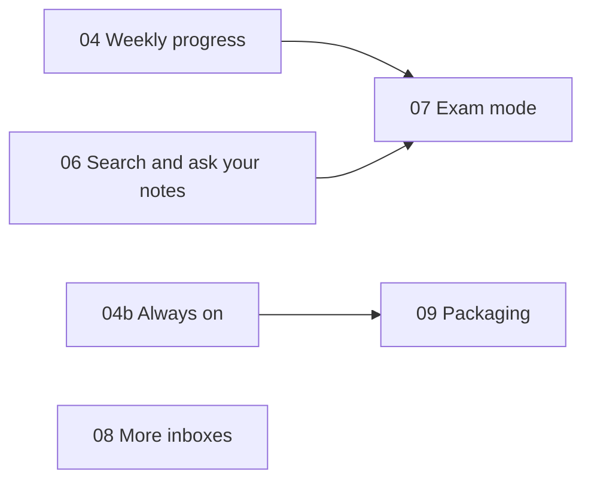

# ContextOS plan

What ContextOS is for, where it stands, and how it grows: every next phase with
its design, its tests and what "done" means. How the current code works is in
[ARCHITECTURE.md](ARCHITECTURE.md). Status as of 30 October 2026.

## 1. Why ContextOS exists: what makes student life hard

| What is hard | What it looks like | How ContextOS eases it | Status |
|---|---|---|---|
| Files everywhere | hundreds of PDFs in Downloads named `Module3_final(2).pdf`, `CamScanner 10-14-2026.pdf`, WhatsApp images; the night before an exam the notes cannot be found | reads every file and sorts it into `Semester / Subject / Type`, with approval and undo | done (phases 00-02) |
| Deadlines hidden inside files | "last date of submission" on page one of an assignment sheet or a notice | finds dates next to deadline words, suggests them, and asks when an assignment has none | done (03) |
| No single list of what is due | deadlines spread over notices, sheets, chats and memory | one Assignments page, soonest first, and Khushi's briefing | done (03); more sources in 08 |
| Getting started | a big assignment feels too big to begin | a to-do list of small steps written from the sheet's own questions | done (03) |
| Remembering too late | the deadline comes back to mind the night before | reminders 5 and 3 days before, with progress on the steps | done (03) |
| Not knowing where the time went | busy all week, little done | study timer, weekly chart, an honest summary | phase 04 |
| Switching between apps | opening YouTube, Spotify, Classroom and notes one by one | ask Khushi by text or voice: "open my OS notes", "play lofi" | done (05, 05b) |
| Finding one answer in the notes | scrolling through ten PDFs for one definition | search inside every file, with the page; questions answered from the notes | phase 06 |
| Exam preparation | which topics matter, which questions repeat, how much is left | exam countdown, past-paper analysis, a revision plan | phase 07 |
| It has to run without fuss | starting a server by hand every day | starts with the laptop on Windows and Linux; one-click install | phases 04b, 09 |
| Money and privacy | paid AI subscriptions; uploading every file to a cloud | runs on the laptop; free-tier AI is optional and only gets snippets; rules work offline | done (core rule) |
| Old, low-power laptops | no GPU, patchy internet | CPU only; every feature works without AI | done (core rule) |

## 2. Where we are

| Phase | What it gave | State |
|---|---|---|
| 00 Scaffold | FastAPI, SQLite tables, `contextos serve`, React shell | done |
| 01 AI layer | Gemini and Groq over HTTP, JSON mode, rate limits, cache, model chains | done |
| 02 File organiser | scan, read (PDF, OCR, Word, PowerPoint), classify, plan, move, undo, folder watcher | done |
| 03 Assignments and reminders | tasks from files, Khushi's questions, to-do steps, reminders, briefing | done |
| 04 Weekly progress | study timer, weekly chart, summary | **next**, designed in section 4 |
| 05 Khushi chat and local actions | rules-first commands, AI fallback, allowlisted actions, Chrome extension | done |
| 05b Voice | spoken replies, Chrome mic | done |
| 04b, 06-09 | always on, notes search, exam mode, more inboxes, packaging | planned in sections 5-9 |

Checked on 30 October 2026 on Windows: 282 backend tests (281 pass, one skips
without Tesseract), 31 frontend tests and 13 extension tests, all green; ruff
clean; the frontend builds. The Windows fixes for plan destinations and app
detection are in `bcb3706`. The whole interface follows the design system in
[DESIGN.md](DESIGN.md), adopted the same day.

## 3. Roadmap

| Order | Phase | Goal | Rough size | Needs |
|---|---|---|---|---|
| 1 | 04 Weekly progress | see and steer the week | M | |
| 2 | 04b Always on, everywhere | starts with the laptop; same on Windows and Linux; CI | S-M | |
| 3 | 06 Search and ask your notes | find answers in your own files, with the page | M-L | |
| 4 | 07 Exam mode | prepare for exams with a plan | L | 04, 06 |
| 5 | 08 More inboxes | deadlines from WhatsApp, Classroom and Gmail; calendar export | M | |
| 6 | 09 Packaging | install without Python or Node | M-L | 04b |

S is a day or two, M about a week, L several weeks of part-time work. These are
estimates, not promises.



## 4. Phase 04: weekly progress (next)

**Goal.** Show the student where the week went and nudge them gently, without
spending AI quota unless they ask.

**What the student can do**

- Press Start when sitting down to study DBMS, and Stop when done.
- "Start a 25 minute timer for OS": it ends by itself.
- "I studied CN for an hour and a half yesterday": log a forgotten session.
- See the week: minutes per day by subject, assignments finished, files
  organised, the streak.
- "How was my week?": a short summary. "Ask Khushi" for a fuller one from the
  AI.

### Data

`StudySession` already exists (`subject_id`, `started_at`, `ended_at`,
`minutes`). Phase 04 adds, all nullable or with defaults as the migration rule
requires:

| New field | Type | Meaning |
|---|---|---|
| `planned_minutes` | `int \| None` | a countdown that ends by itself |
| `source` | `str = "timer"` | `timer`, `manual` or `chat` |
| `capped` | `bool = False` | closed at the safety limit, so the page asks the student to check it |
| `note` | `str \| None` | what was studied, optional |

When a session ends, an `ActivityEvent(kind=session, ref_id=session.id)` is
written, and it is deleted with the session, the same way finished tasks work.
New setting: `STUDY_SESSION_MAX_HOURS`, default 4.

### Rules (`progress/timer.py`)

1. At most one session runs at a time. Starting a new one stops the running one
   first, so switching subject is one tap.
2. Minutes come from the server's timestamps, never from the browser's counter,
   so a closed tab or a sleeping laptop cannot corrupt them.
3. A countdown ends at `started_at + planned_minutes` even if nobody presses
   Stop: it is closed the next time anything reads the timer. No scheduler is
   needed.
4. A session without a countdown that stays open longer than
   `STUDY_SESSION_MAX_HOURS` is closed at that limit and marked `capped`.
5. Sessions shorter than one minute are discarded as accidental taps.
6. A logged session is 1 to 720 minutes, on a day within the last 14 days, never
   in the future.

### Weekly numbers (`progress/stats.py`, pure functions)

- A week runs from Monday 00:00 to the next Monday 00:00, local time.
- Stored times are UTC instants, so each one is converted to local time before
  it is put on a day. The time zone is a parameter (the laptop's by default), so
  tests can pass fixed offsets such as `timezone(timedelta(hours=5, minutes=30))`
  and do not depend on the `tzdata` package, which Python's `zoneinfo` needs on
  Windows.
- A session that crosses midnight is split between the two days. One that
  crosses the start or end of the week only counts its part inside the week.
- Output: for each of the 7 days, minutes per subject; totals per subject;
  assignments finished (from `task_done` events); files organised (the sum of
  `files_organized` counts); the streak; last week's total for comparison.
- Streak: consecutive days with any study, counting back from today. Today only
  breaks the streak once it is over, so a morning without study yet does not
  reset it.

### Summary (`progress/summary.py`)

- **Rules summary, always available**: total time and the change from last week
  ("6 h 10 min, 1 h 20 min more than last week"), the top subject, a subject
  with a deadline in the next 7 days and under an hour of study this week ("the
  DBMS assignment is due Friday and DBMS got 20 minutes this week"),
  assignments finished, files organised, the streak.
- **AI summary, only when the student presses the button**: the AI sees the
  numbers, subject names and assignment titles, never document text. It
  returns a headline, up to 3 things that went well, up to 3 to watch, and one
  next step. Any failure falls back to the rules summary with a short note. An
  identical week costs nothing twice (the AI cache).
- The wording encourages and never shames, in the rules and in the prompt.
- Khushi's briefing gets one rules line, such as "You've studied 3 h 20 min this
  week".

### API (`api/progress.py`, under `/api/progress`)

| Method and path | Does |
|---|---|
| `GET /timer` | the running session, or null (a finished countdown is closed first) |
| `POST /timer/start` | `{subject_id?, planned_minutes?}`; stops a running session first |
| `POST /timer/stop` | closes the running session and returns it |
| `POST /sessions` | logs a session `{subject_id?, minutes, day?}` |
| `PATCH /sessions/{id}` | fixes the minutes, subject or note (for capped sessions) |
| `DELETE /sessions/{id}` | removes a session and its activity event |
| `GET /week?start=YYYY-MM-DD` | the week's numbers and the rules summary (this week by default) |
| `POST /summary?start=YYYY-MM-DD` | the AI summary, falling back to the rules summary |

### Khushi

Rules first, every pattern case-insensitive (the existing test checks it):
"start studying DBMS", "start a 25 minute timer for OS", "stop the timer",
"I'm done studying", "I studied DBMS for 2 hours yesterday", "how much did I
study this week?", "how was my week?". The same actions join the AI's
allowlist (`ChatPlan.action`) as `start_timer`, `stop_timer` and `week_stats`.

### Pages

- Everything follows [DESIGN.md](DESIGN.md): lilac is Progress's colour, and the
  chart uses capsule bars like the placeholder's preview.
- `/progress` replaces the placeholder:
  - a timer card: subject picker in subject colours, 25 and 50 minute presets
    or no limit, Start and Stop, and the elapsed time worked out from
    `started_at`, so it survives a reload;
  - this week as a stacked bar chart (Recharts, already installed): minutes per
    day, one colour per subject, with previous and next week buttons;
  - the numbers: study time against last week, assignments finished, files
    organised, the streak;
  - the summary card with an "Ask Khushi" button;
  - the week's sessions, with edit and delete.
- While a session runs, a small timer pill shows in the header of every page.
- The Dashboard gets a "This week" card linking to `/progress`.
- When a countdown ends and the page is open, Khushi says so (voice if on). The
  server closes the session either way.

### Tests

All must pass on Windows and Linux.

- `tests/test_progress.py`:
  - timer: minutes from timestamps (with an injected clock); starting while one
    runs stops it; a countdown closes itself at its planned end; the cap sets
    `capped`; sessions under a minute are dropped; there is never more than one
    running session;
  - numbers: split at midnight; clipped at the week's edges; correct days with
    `+05:30` and `-05:00` offsets; an empty week; the streak with and without
    study today; finished assignments and organised files counted, an un-ticked
    task not counted;
  - summary: the rules wording for each case; the AI path with the fake LLM;
    an AI exception falls back to rules with a note; the prompt the fake LLM
    receives contains no document text;
  - API: every endpoint through the `client` fixture, including 404 and 422
    cases.
- `tests/test_chat.py`: each new command, the case-insensitive test, the
  briefing line.
- vitest for the pure helpers in a new `frontend/src/lib/progress.ts`:
  formatting minutes (95 becomes "1 h 35 min") and moving to the previous and
  next week, on top of `startOfWeek` in `lib/labels.ts` (already tested).
- By hand: start a 1-minute countdown, reload the page halfway (the timer
  carries on), restart the server halfway (still running), let it finish
  (closed at 1 minute), see the chart update; with `LLM_PROVIDER=none` the
  summary still works; with a key the "Ask Khushi" button works.

**Done when** all of the above passes, `/progress` no longer says "coming
soon", CLAUDE.md's phase table says 04 is done, ARCHITECTURE.md lists the new
fields and routes, and no new runtime dependency was added.

## 5. Phase 04b: always on, everywhere

**Goal.** ContextOS starts with the laptop and behaves the same on Windows and
Linux, and every push is tested on both.

1. **Start on login**: `contextos autostart on|off|status`.
   - Linux: writes `~/.config/systemd/user/contextos.service` (`ExecStart` the
     venv's `contextos serve`, `Restart=on-failure`) and runs
     `systemctl --user enable --now contextos`. Started this way, app launches
     no longer inherit a sandboxed terminal's restrictions.
   - Windows: a per-user value under
     `HKCU\Software\Microsoft\Windows\CurrentVersion\Run` running the venv's
     `pythonw.exe -m contextos.cli serve`, which needs no admin rights and
     opens no console window.
   - With no console, logs go to `DATA_DIR/contextos.log` (rotated). Under
     `pythonw`, `sys.stdout` is `None`, and Uvicorn's log formatter calls
     `sys.stdout.isatty()`, so stdout and stderr must point at the log file
     before Uvicorn starts.
   - macOS (a LaunchAgent) waits until a Mac is available to test on.
2. **Find `.env` wherever the server starts**: read `backend/.env` by its
   absolute path (found from the package's location) as well as `.env` in the
   current folder, which overrides it. pydantic-settings accepts several env
   files, and later files win.
3. **OCR on Windows**: if `tesseract` is not on PATH, look in
   `%ProgramFiles%\Tesseract-OCR\tesseract.exe` and point pytesseract at it; a
   new `TESSERACT_CMD` setting overrides the search. The README gains
   `winget install UB-Mannheim.TesseractOCR`. The Organize page's hint tells
   everyone to run `sudo apt install tesseract-ocr`, even on Windows: it should
   show the winget command there, which needs the platform in `/api/health`.
4. **Watch subfolders**: watch recursively, but only react to files within
   `SCAN_MAX_DEPTH` levels and never to files inside the library, which can sit
   inside Downloads.
5. **Extension port**: the Settings page warns when `PORT` is not 8000, the
   only port the extension knows. A port setting in the extension can come
   later.
6. **CI**: a GitHub Actions workflow runs every suite (pytest, ruff, vitest,
   the frontend build, oxlint, the extension tests) on Ubuntu and Windows for
   every push.
7. **Clean-up**: drop APScheduler from the `reminders` extra; fix the 3 oxlint
   warnings; trim AI cache entries older than 90 days at startup; Windows
   commands (`.venv\Scripts\...`) in the README and CLAUDE.md.

**Tests.** The autostart files and registry values are built by pure functions
and written through a fake (a pretend `winreg`, a pretend `systemctl`, as
`tests/test_actions.py` already does), so no test changes the real login items. The
Tesseract search, the env-file order, the watcher's depth filter and the
`pythonw` start-up path (with `sys.stdout = None`) each get a test.

**Done when** after a restart, on Windows and on Linux, ContextOS is running,
the watcher reacts, reminders arrive and the extension connects, all without
opening a terminal, and CI is green on both systems.

## 6. Phase 06: search and ask your notes

**Goal.** Find an answer inside your own files in seconds, with the file and
the page.

**Step 1: search, no AI.**

- Index the full text of every organised document, page by page: PDF pages,
  Word paragraphs, slides. OCR only pages without text, only when Tesseract is
  installed, and only up to a page limit per file, to keep the CPU free.
- Store it in an SQLite FTS5 table (`doc_id`, `page`, `text`), ranked with
  `bm25()` and shown with `snippet()`. FTS5 works in the SQLite of the Python on
  the Windows PC (SQLite 3.45.3, checked 30 October 2026); check for it at
  startup on every system and fall back to a plain `LIKE` search when it is
  missing.
- Re-index only documents whose `sha256` changed; remove rows for files that
  are gone; index on a background thread after each scan or move, like the
  scan job.
- `GET /api/search?q=&subject=&type=` returns the file, page and snippet.
  Opening a result serves the PDF from the library through the API, so
  Chrome's viewer can jump to `#page=N`. A file opened through the operating
  system cannot be told a page.
- Khushi: "find normalisation in my DBMS notes" shows results as file cards
  with page numbers; "open it" opens the first one at its page.
- Nothing leaves the laptop.

**Step 2: ask your notes, AI and opt-in.**

- Split pages into passages of about 1,000 characters that overlap a little,
  and turn each into an embedding vector.
- Embeddings run locally by default with a small English model on the CPU
  (for example through `fastembed`), so notes stay private; Gemini's embedding
  API is an option for those who choose it. Vectors live in SQLite and are
  compared with NumPy: a student's library is thousands of passages, not
  millions.
- The best few passages go to the AI with "answer only from these, cite the file
  and page, say so when they do not answer it". Without the AI, Khushi shows the
  passages themselves.
- **A privacy decision**: this sends whole passages of notes to the AI, far more
  than `LLM_SNIPPET_CHARS`. It needs its own off-by-default setting, explained
  in Settings, and ARCHITECTURE.md's privacy table must say so.
- New dependencies go in a new `notes` extra, imported lazily.

**Step 3: syllabus map.**

- Read `syllabus` documents into modules and topics ("Module 1", "Unit I", the
  numbered topic lines), with the AI optional to tidy the result.
- Link notes and question papers to topics through the search index.
- For each subject, show module, topics and coverage: notes found, past
  questions, study time from phase 04.

**Tests.** Incremental indexing, ranking and snippets on fixture files, removed
files leave the index, search works with `LLM_PROVIDER=none`; retrieval with
fake embeddings; answers cite real pages and refuse when nothing matches; no AI
call while the opt-in is off; syllabus parsing on several real layouts.

## 7. Phase 07: exam mode

Needs phases 04 and 06.

- **Exam dates**: added by hand, by chat ("my DBMS exam is on 12 December"), or
  found in notices and timetables as suggestions, the way deadlines are. A
  countdown appears in the briefing.
- **Past papers**: split question papers into questions ("Q.1", "1 a)", "(10
  Marks)"), group similar questions across years by TF-IDF similarity on the
  CPU, and rank each module's questions by how often they come up.
- **Revision plan**: from the days left, the syllabus map and the study already
  done, a plan for each day; a missed day rolls forward; Khushi reminds the
  student of today's topics.
- **Flashcards and quick quizzes** from the notes: written by the AI when the
  student opts in, or made by rules from definition lines ("X is ..."), and
  scheduled with spaced repetition (SM-2).

**Tests.** Question splitting and grouping on real paper layouts, the planner's
schedule for edge cases (exam tomorrow, no syllabus, everything studied), SM-2
intervals, AI and rules versions of the cards.

## 8. Phase 08: more inboxes

Deadlines do not only arrive as files in Downloads.

- **WhatsApp**: there is no API for personal accounts, so import an exported
  chat (`.txt` from WhatsApp's "Export chat") and pick out lines with deadline
  words. Images saved from WhatsApp into a watched folder are already read with
  OCR.
- **Google Classroom**: coursework and due dates, read-only, through the
  Classroom API with OAuth (an installed-app flow with a loopback redirect,
  tokens kept on the laptop). It needs a Google Cloud project, and a college's
  Google Workspace admin may block it.
- **Gmail**: read-only search for college mail with deadline words, through the
  same OAuth.
- **Calendar**: export assignments as an `.ics` file to import into Google
  Calendar or a phone. Google Calendar cannot subscribe to a localhost address,
  so it is a file, not a feed.
- Everything imported is a suggestion, like deadlines found in files.

**Tests.** Recorded fixtures for every source; no network in tests; OAuth
tokens never logged.

## 9. Phase 09: packaging

**Goal.** A student installs ContextOS without Python or Node.

- **Build** with PyInstaller as a one-folder app containing the backend and
  `frontend/dist`. `frontend.FRONTEND_DIST` must find the bundled UI
  (`sys._MEIPASS` in a frozen app), and `.env` moves into `DATA_DIR`.
- **Installers**: Inno Setup on Windows (app, optional Tesseract, Start menu
  entry, a start-on-login box from 04b); an AppImage or `.deb` with the systemd
  user unit on Linux.
- **First run**: a setup page for folders, subjects and an optional AI key.
- **Tray icon** (pystray): open, pause watching, quit.
- **Updates**: check GitHub releases when asked; never install by itself.

**Tests.** CI builds on Windows and Linux and smoke-tests the frozen app:
`/api/health` answers and `/` returns `index.html`.

## 10. Ideas backlog

| Idea | Eases | Size | Notes |
|---|---|---|---|
| Attendance tracker per subject | surprise shortfalls against the college's minimum | S-M | warn below the minimum; "can I skip tomorrow?" |
| Timetable from a photo or PDF | "what's my next class?" | M | OCR plus rules; feeds the attendance tracker |
| SGPA and CGPA calculator | working out grades | S | credits can come from syllabus documents |
| Offline AI through Ollama | no internet, no quota, full privacy | M | a third provider: only `_request` to write; slow on a CPU, so for chat and to-do lists, not bulk sorting |
| Offline voice (Piper speech, faster-whisper listening) | the mic no longer sends audio to Google | M | CPU models |
| Focus mode | distraction while studying | S-M | the extension blocks chosen sites while a timer runs (Chrome's `declarativeNetRequest`) |
| Real autoplay | "play" opens search results today | M | Spotify Web API (playback control needs Premium) or the YouTube Data API |
| Duplicates helper | duplicate copies clutter Downloads | S | move reported duplicates into a Duplicates folder, with undo; never delete |
| Lab record tracker | which experiments are done | S-M | from the lab manual's experiment list |
| Sunday evening digest | planning the week | S | one notification, built by rules |
| Hindi and Kannada | comfort | M | listening already supports Hindi |
| Phone companion | notices photographed on a phone | L | the API is localhost-only by design, so this needs pairing and a token first |
| Tidy names without moving | some want the names, not the folders | S | a rename-only plan, same approval and undo |
| Group project checklist | shared work | M | export and import, to stay local-first |

## 11. How every change is checked

Every change, however small, meets all of these before it is committed.

1. **A short design first**: what, why, data, API, UI and failure cases, in the
   commit message or in this file.
2. **Tests with the code**: unit tests for logic, API tests through the
   `client` fixture, and a regression test for every bug fixed.
3. **Every suite passes, on Windows and on Linux** (CI runs both once 04b
   lands; until then run them on both machines). From the repo root:

   ```bash
   (cd backend && .venv/bin/python -m pytest -q && .venv/bin/ruff check src tests)
   (cd frontend && npm test && npm run build && npm run lint)
   node --test browser-extension/*.test.mjs
   ```

   On Windows the venv's programs are in `.venv/Scripts/` instead of
   `.venv/bin/` (the same lines work in Git Bash).
4. **Works without AI**: with `LLM_PROVIDER=none`, and when the AI raises any
   exception (test it with the fake LLM).
5. **Nothing new leaves the laptop** unless the phase says so and the student
   opted in; the privacy table in ARCHITECTURE.md is updated.
6. **The safety rules hold**: no deletes, nothing moves without approval,
   allowlisted actions only, nothing real launched in tests.
7. **Honest**: what Khushi says matches what happened.
8. **Portable paths**: `pathlib` for files, `as_posix()` for anything the UI
   shows or splits, Windows' reserved names respected, no hard-coded `/`.
9. **Additive schema changes only**: new columns nullable or with a default.
10. **Tried by hand on the demo files**:

    ```bash
    cd backend
    .venv/bin/python scripts/make_demo_files.py ~/contextos-demo/Downloads
    WATCH_DIRS=~/contextos-demo/Downloads LIBRARY_ROOT=~/contextos-demo/Library .venv/bin/contextos serve
    ```

    In PowerShell, from `backend`:

    ```powershell
    .venv\Scripts\python scripts\make_demo_files.py $HOME\contextos-demo\Downloads
    $env:WATCH_DIRS = "$HOME\contextos-demo\Downloads"
    $env:LIBRARY_ROOT = "$HOME\contextos-demo\Library"
    .venv\Scripts\contextos serve
    ```

    Then: scan, approve and undo on Organize;
    answer a question and write a to-do list on Assignments; send a test
    notification from Settings; in the chat try "what's due this week?",
    "open calculator" and "search black holes on wikipedia"; in Chrome, try
    the mic.
11. **Docs updated**: CLAUDE.md for rules and decisions, ARCHITECTURE.md for
    structure, this file for status.
12. **The look holds**: new screens follow [DESIGN.md](DESIGN.md) and are
    checked in light and dark mode, at 375px wide, and with the keyboard.

## 12. Risks

| Risk | What would happen | What we do |
|---|---|---|
| Free AI tiers change: models retire, quotas shrink | AI features fail | rules first; model chains in settings; Groq as a second provider; offline AI as an idea |
| OCR misreads phone photos | wrong titles or dates | confidence is shown; found dates are only suggestions |
| The mic works in Chrome only and sends audio to Google | privacy, one browser | Settings says so; offline listening is in the backlog |
| "Ask your notes" sends note text | privacy | off by default, local embeddings by default |
| Linux and Windows drift apart | "works on my machine" bugs | CI on both from 04b; tests use fakes, not the real OS |
| Installers get large (PyMuPDF, Tesseract, models) | slow downloads | a one-folder build; optional parts |
| Colleges block Classroom access | that importer is useless there | WhatsApp export and `.ics`, which need no permission |
| Weekly numbers make students feel guilty | they stop using it | encouraging wording; streaks can be hidden |

## 13. Decisions for you

1. Does the week start on Monday (planned) or Sunday?
2. Is 4 hours the right cap for a forgotten timer?
3. After phase 04: always-on (04b) next, or notes search (06)?
4. For "ask your notes": local embeddings (private, a one-time model download)
   or Gemini (no download, sends passages)?
5. The first new inbox in phase 08: WhatsApp export, Google Classroom or Gmail?
6. The first installer in phase 09: Windows or Linux?
